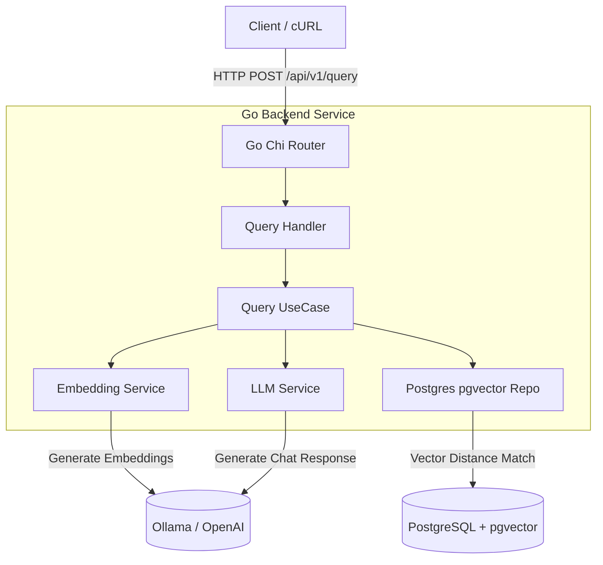

# 🚀 Go RAG Knowledge Assistant (Backend Service)

> Um microsserviço de RAG (**Retrieval-Augmented Generation**) de alta performance desenvolvido em **Go**, projetado com **Clean Architecture**, busca vetorial utilizando **PostgreSQL (`pgvector`)** e integração com modelos de linguagem locais (**Ollama**) ou APIs externas.

---

## 🏗️ Arquitetura do Sistema

O projeto segue estritamente os princípios de **Clean Architecture**, isolando as regras de negócio das camadas de infraestrutura, banco de dados e frameworks HTTP.



---

## 🛠️ Stack Tecnológica

- **Linguagem:** Go 1.26
- **Roteamento HTTP:** `go-chi/chi/v5`
- **Banco de Dados & Vetores:** PostgreSQL 16 com extensão **`pgvector`**
- **Inteligência Artificial / LLM:** Ollama (Llama 3.2 / Embeddings)
- **Conteinerização:** Docker & Docker Compose (Multi-stage builds)

---

## 📂 Estrutura do Projeto

```text
.
├── cmd/
│   ├── api/             # Ponto de entrada da API REST HTTP
│   └── ingest/          # Script CLI para ingestão de documentos
├── internal/
│   ├── domain/          # Entidades de domínio e contratos de interfaces
│   ├── usecase/         # Regras de negócio (RAG Pipeline)
│   ├── repository/      # Camada de persistência (PostgreSQL / pgvector)
│   └── delivery/        # Handlers HTTP, rotas e middlewares (Chi)
├── pkg/                 # Clientes externos (Ollama, OpenAI, Parsers PDF/MD/TXT)
├── data/
│   └── input/           # Diretório monitorado para ingestão de arquivos
├── migrations/          # Migrations SQL do PostgreSQL
├── Dockerfile           # Build multi-stage otimizado (~25MB)
└── docker-compose.yml   # Orquestração de serviços (API, Postgres, Ollama)
```

---

## 🚀 Guia de Execução (Quickstart)

Para rodar todo o ecossistema (API Go, Banco Vetorial e Ollama) com apenas um comando via Docker, siga os passos abaixo:

### 1. Pré-requisitos

- **Docker** e **Docker Compose** instalados na sua máquina.

### 2. Subir o Ambiente

Na raiz do projeto, execute:

```bash
docker compose up --build -d
```

Isso irá:

1. Subir o **PostgreSQL** com a extensão `pgvector` e rodar as migrações automáticas.
2. Iniciar o serviço do **Ollama**.
3. Compilar e subir o microsserviço **Go** (`rag_api`) na porta `8080`.

### 3. Verificar os Logs

```bash
docker logs -f rag_api
```

_(Você deverá ver a mensagem: `🌐 Servidor HTTP ouvindo na porta 8080...`)_

---

## 📡 Endpoints da API

### 1. Consultar a Base de Conhecimento (`POST /api/v1/query`)

Realiza a busca semântica no `pgvector` cruzando com o contexto recuperado para gerar a resposta via LLM.

**Exemplo com cURL:**

```bash
curl -X POST http://localhost:8080/api/v1/query \
  -H "Content-Type: application/json" \
  -d '{
    "question": "Qual é o e-mail para acionar a garantia na AcmeShop e qual o prazo de análise técnica?"
  }'
```

**Payload de Resposta Esperado (`200 OK`):**

```json
{
  "answer": "Para acionar a garantia, você deve entrar em contato com o suporte através do e-mail garantia@acmeshop.com.br ou enviando uma mensagem para o WhatsApp oficial.",
  "sources": [
    {
      "document_title": "politica_garantia_suporte.txt",
      "source_uri": "data/input/politica_garantia_suporte.txt",
      "chunk_id": "ce396716-7e7e-4bee-ad0d-70b06f7285c0"
    }
  ]
}
```

---

## 💡 Destaques de Engenharia

- **Clean Architecture:** Desacoplamento total entre infraestrutura e domínio, permitindo trocar o banco de dados ou o provedor de LLM alterando apenas implementações de interface.
- **Busca Vetorial Eficiente:** Uso de `pgvector` com indexação por distância de cosseno para recuperação de contexto de alta precisão.
- **Build de Produção Otimizado:** Utilização de `Dockerfile` _multi-stage_ gerando um binário estático em container Alpine leve.
